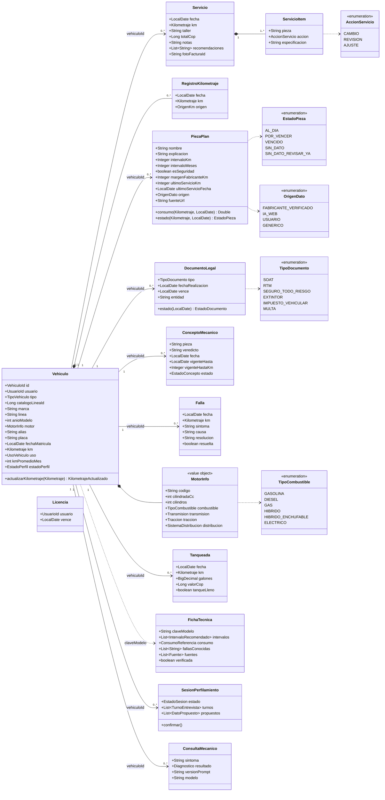
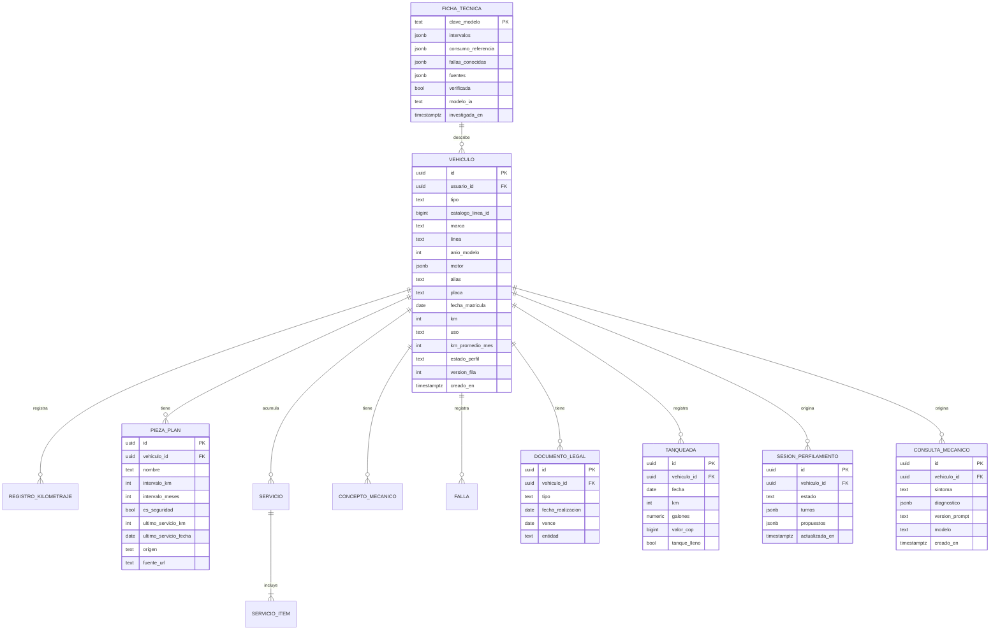

# Modelo de dominio del MVP

Diseño original, actualizado el 2026-10-21 con la ampliación aprobada (ADR 0005, 0016, 0017, 0018 y 0020): identidad por cuenta (`usuarioId`), servicio como factura con trabajos, concepto del mecánico, estado `SIN_DATO_REVISAR_YA`, documentos ampliados y licencia por cuenta. Las tablas vigentes están en `docs/datos.md`; las de abajo son guía. Los módulos se relacionan por id (`vehiculoId`, `usuarioId`), no por referencia de objeto; el diagrama los junta para leerlo completo.

## Diagrama de clases

La `Licencia` es de la cuenta (`usuarioId`), no de un vehículo, y solo guarda la fecha de vencimiento (RF-DOC-07). El kit de carretera es una lista sin fecha ligada al vehículo (RF-DOC-05). Solo un `ServicioItem` con `accion = CAMBIO` reinicia el intervalo de su pieza (ADR 0017).

`claveModelo` = `marca|linea|anioModelo|cilindradaCc` normalizado (minúsculas, sin tildes). Varias personas con el mismo modelo comparten la ficha investigada, lo que abarata la IA y es la base de los datos agregados.

## Tablas (PostgreSQL)

Índices mínimos: `vehiculo(usuario_id)`, `pieza_plan(vehiculo_id)`, `documento_legal(vence)`, `tanqueada(vehiculo_id, km)`. Todas las tablas hijas con `ON DELETE CASCADE` para que eliminar un vehículo borre todo lo suyo.
