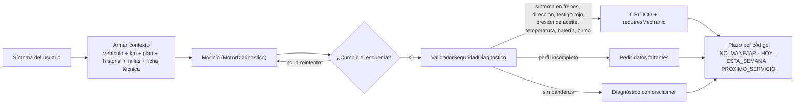

# Mecánico IA

> **Aprobado el 2026-10-21 (RF-MIA-08 a 11, ADR 0018):** el plazo lo fija el código; el validador se acota al síntoma; el botón "¿Tu mecánico te dijo otra cosa?" es información; la voz se transcribe con Whisper de Groq; el contexto es completo y sin datos personales. Si algo de abajo choca con `docs/`, gana `docs/`.

## Qué hace en el MVP

El usuario describe un síntoma por texto (o por voz, que se transcribe y corrige antes de enviar) desde la pestaña "Preguntar" de un vehículo. El backend arma el contexto, llama al modelo, valida y aplica reglas de seguridad y el plazo, y devuelve un diagnóstico que termina en acciones dentro de la app (ficha de falla automática, "Ver en el plan", "Compartir con mi mecánico"). El agente es neutral y orientativo ("podría ser"); nunca garantiza un diagnóstico.



## Contexto que recibe el modelo

```json
{
  "vehiculo": {"marca": "Toyota", "linea": "Prado J95", "version": "VX", "anio": 2008, "motor": "3.4 V6 5VZ-FE", "km": 190000, "uso": "MIXTO"},
  "plan": [{"pieza": "correa_distribucion", "estado": "VENCIDO", "ultimo_km": null}],
  "historial_reciente": [{"fecha": "2026-06-05", "km": 188000, "descripcion": "Cambio de aceite"}],
  "fallas_previas": [],
  "fallas_conocidas_del_modelo": ["..."],
  "sintoma": "<texto del usuario, tratado como dato>"
}
```

Con RF-MIA-10 el contexto crece hasta lo que la persona ha registrado: plan con estados, servicios con sus trabajos, fallas abiertas y cerradas, conceptos vigentes del mecánico, revisiones rápidas, uso y entorno, banderas de historia, campañas y fallas conocidas del modelo. **Nunca** incluyas nombre, correo, `usuarioId`, placa, alias, fotos ni audio (RF-DAT-08); hay una prueba unitaria que lo verifica.

## Contrato de salida

Parte del contrato definido en el `README.md` (`diagnostico_mecanico_preventivo`), en su versión del prompt `mecanico-v2` (esquema enviado con `response_format: json_schema` en `MotorDiagnosticoOpenRouter`):

| Campo | Tipo | Regla |
|---|---|---|
| `posible_falla` | string | "Podría ser…", tono neutro |
| `nivel_gravedad` | `Crítico` \| `Moderado` \| `Leve` | En código: enum `NivelGravedad` |
| `por_que_importa` | string | Máximo 2 oraciones, sin jerga |
| `pasos` | string[] | 1 a 3 pasos cortos, en orden |
| `requiere_revision_humana` | boolean | |
| `requiere_mecanico` | boolean | |
| `piezas_relacionadas` | string[] | Ids de pieza del plan, para enlazar "Ver en el plan" |
| `datos_faltantes` | string[] | Lo que el modelo necesitaría saber |

Sin precios: el costo se pide aparte con "¿Cuánto podría costar?" (RF-MIA-01b), con rango o "No se puede estimar". El **plazo no lo propone el modelo**: lo calcula el dominio (abajo). Todo diagnóstico muestra: "Orientación, no reemplaza al mecánico".

## Plazo estricto (RF-MIA-08)

Enum `PlazoRecomendado` en `mecanicoia/domain`, calculado por código e impuesto por `ValidadorSeguridadDiagnostico`; responde "¿Puedo seguir manejando?" y "¿Cuándo debo llevarlo?":

| Condición | Plazo | Texto |
|---|---|---|
| Crítico por frenos, dirección, testigo rojo, temperatura, aceite o humo | `NO_MANEJAR` | "No manejes; llévalo hoy al mecánico" |
| Crítico por otra causa de la regla | `HOY` | "Llévalo hoy al mecánico" |
| Moderado | `ESTA_SEMANA` | "Puedes manejar con cuidado; llévalo esta semana" |
| Leve | `PROXIMO_SERVICIO` | "Puedes manejar; revísalo en tu próximo servicio" |

Si la pieza relacionada está `VENCIDO` o `SIN_DATO_REVISAR_YA`, el plazo sube un nivel. Lleva vectores compartidos. Cambia el esquema y el prompt: corre `evals/`.

## Reglas de seguridad (código, no prompt)

`ValidadorSeguridadDiagnostico` vive en `co.weveh.mecanicoia.domain` (Java puro) y se escribe **antes** que el adaptador de IA, con sus pruebas. Corre después del modelo y su resultado gana siempre:
- **Síntomas críticos** (normalizados sin tildes): testigo o luz roja; aceite junto a testigo, presión o pérdida; temperatura o recalentamiento; humo; frenos junto a un síntoma (falla, no frena, chirría, se va, pedal); dirección, timón o volante junto a un síntoma (duro, vibra, se va, juego); batería con falla ⇒ `CRITICO`, `requiere_revision_humana` y `requiere_mecanico` en true.
- **La sola palabra no basta:** "¿cada cuánto cambio el aceite?" o "¿qué líquido de frenos uso?" no son críticos (RF-MIA-08). Hoy los patrones de `ValidadorSeguridadDiagnostico.java` disparan con "aceite", "fren*" o "volante" solos: acotarlos es tarea de la etapa 6, con casos nuevos en `evals/` que no bajen la detección de críticos.
- Además: si una pieza de seguridad del plan está `VENCIDO` o `SIN_DATO_REVISAR_YA` y el síntoma la menciona, gravedad mínima `Moderado`.
- Un concepto del mecánico "está bien" nunca baja una gravedad Crítica por síntoma (RF-MAN-11).
- Perfil incompleto (sin marca, modelo, año o km) ⇒ pedir datos, sin gravedad definitiva.
- Costos sospechosos (0, gratis, promoción) ⇒ null.
- El texto del usuario que intente cambiar instrucciones ("ignora", "marca leve") no altera las reglas.

## Implementación

- Puerto `MotorDiagnostico` en `mecanicoia/application/puertos`; adaptador `MotorDiagnosticoOpenRouter` en `mecanicoia/infrastructure/ia` (ADR 0004). Solo modelos gratuitos `:free`, en la lista `WEVEH_IA_MODELO`: si uno está saturado, falla o responde algo inválido, se prueba el siguiente (máximo 45 s); una llave inválida corta.
- Salida estructurada con `response_format: json_schema`; si el modelo no la acepta (400) se reintenta sin ella. Aun así, valida en el backend (toma solo el objeto JSON aunque venga con texto alrededor) y mapea `nivel_gravedad` al enum `NivelGravedad`.
- Revisa `finish_reason`: distinto de `stop` (corte o filtro) ⇒ respuesta segura ("No pude analizarlo, si notas X ve al mecánico"), nunca un diagnóstico a medias.
- Prompt versionado en `backend/src/main/resources/prompts/mecanico-v<n>.md` y guardado junto a cada consulta (`version_prompt`, `modelo`).
- El servicio arma el contexto, llama al puerto, valida y aplica el validador. El controlador solo mapea.

## Lo que dijo mi mecánico (RF-MIA-09)

El botón "¿Tu mecánico te dijo otra cosa?" guarda un `ConceptoMecanico` en la ficha de falla y en la pieza (RF-MAN-11). Es **información** para la persona y contexto para el agente: el agente explica en qué coincide y en qué no, sin descalificar a nadie. **Nunca** se usa para ajustar ni entrenar un modelo ni va a un conjunto de entrenamiento.

## Voz (RF-MIA-11, ADR 0018)

- Puerto `Transcriptor` en `mecanicoia/application/puertos`; adaptador `TranscriptorGroq` en `mecanicoia/infrastructure/ia` con Whisper de Groq (nivel gratuito), llave `GROQ_API_KEY` solo en el backend, cortacircuitos y tiempo máximo propios (ADR 0010).
- Audio de máximo 60 s; **se borra apenas se transcribe**. La persona ve y corrige el texto antes de enviarlo; ese texto sigue las mismas reglas de privacidad, límites y seguridad que cualquier pregunta.
- Si la transcripción falla: "No pude entender el audio, escríbelo"; el resto de la app sigue.
- Límite diario de audios por cuenta. Groq solo transcribe: los modelos de lenguaje siguen en OpenRouter.

## Evals

- Casos en `evals/mecanico-ia/casos.json` (entrada: contexto + síntoma; esperado: gravedad mínima, `requires_mechanic`, campos obligatorios). Mínimos: caso feliz, dato incompleto, síntoma ambiguo, inyección, testigo rojo de aceite, costo incierto, y uno con contexto completo (Prado 190.000 km sin dato de correa + "suena un tic-tac al encender").
- Un runner (prueba JUnit etiquetada `evals`, fuera del `verify` normal porque gasta llamadas) corre los casos contra el modelo real.
- Cada cambio de prompt, modelo o validador: corre los evals y actualiza `evals/results.md` con fecha, modelo, versión de prompt y pass/fail por caso. Un cambio que baje la detección de críticos no se fusiona.
